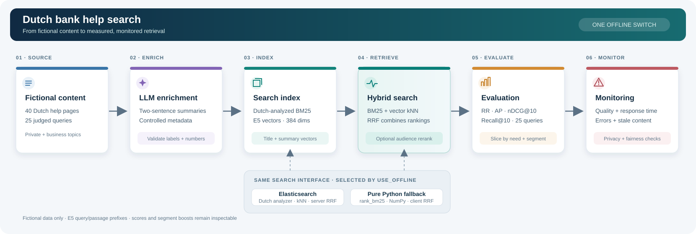

# Dutch Bank Search Demo

A laptop prototype over original, fictional Dutch bank help pages.
Python 3.10+, Docker, and local models; no paid cloud services.

## Architecture



## Current step: final assembly

The repository now retrieves the fictional corpus through BM25, E5 vector search, hybrid
reciprocal-rank fusion (RRF), and an auditable private/business audience adjustment. It also
evaluates all four methods and turns the saved metrics into a portable Product Owner HTML report.
Every push also runs the offline test suite and a real relevance-regression check. A Java 11+
client mirrors the Elasticsearch hybrid request using only the JDK. The notebook and timed demo
script assemble the full interview walkthrough. Source-grounded answer generation is a future extension.

The committed enrichment cache now supplies deterministic two-sentence summaries and controlled
metadata for all pages. See [the enrichment guide](docs/enrichment.md).

See [the indexing guide](docs/indexing.md) to build the Dutch BM25 and vector indexes.
See [the search guide](docs/search.md) to compare lexical, vector, and hybrid results.
See [the personalisation guide](docs/personalisation.md) to compare private and business rankings.
See [the evaluation guide](docs/evaluation.md) to reproduce the metrics and Elasticsearch comparison.
See [the dashboard guide](docs/dashboard.md) to create the standalone Product Owner report.
See [the model card](docs/model_card.md) for governance, privacy, risks, and monitoring controls.
See [the CI guide](docs/ci.md) for the offline test and relevance gate.
See [the Java example](java/README.md) for the dependency-free Elasticsearch client.
See [the timed demo script](docs/demo_script.md) for the 15-minute interview flow and hard questions.

## Setup in 3 commands

Use Python 3.11 for the broadest laptop compatibility. On Intel Macs, use Python 3.10–3.12;
the PyTorch wheels needed by this stack are unavailable for Python 3.13 on that platform.

~~~bash
git clone https://github.com/ISHUKLA/dutch-bank-search-demo.git && cd dutch-bank-search-demo
~~~

~~~bash
python3.11 -m venv .venv && source .venv/bin/activate
~~~

~~~bash
python -m pip install -r requirements.txt -e . && USE_OFFLINE=true python scripts/check_setup.py
~~~

Expected checker output:

```text
Mode: offline
Elasticsearch check: skipped
```

The checker does not import Elasticsearch or make network requests in offline mode.
This step does not download embedding or generation models. Installing dependencies needs internet access.

## Check local Elasticsearch

Start Docker, then run:

```bash
docker compose up -d --wait
USE_OFFLINE=false python scripts/check_setup.py
```

Expected output for a fresh data volume:

```text
Mode: elasticsearch
Elasticsearch version: 8.19.23
Licence type: trial
Licence status: active
Elasticsearch check: OK
```

The 30-day trial enables Elasticsearch's RRF retriever. The service is bound to localhost,
with authentication disabled for this local fictional-data demo.
An existing volume may retain the previous Basic licence: follow the non-destructive activation
instructions in [docs/setup.md](docs/setup.md).

The setup guide includes the complete `docker run` alternative, Elastic's `start-local` option,
credential configuration, expected output, and troubleshooting.

## One backend switch

`USE_OFFLINE=true` selects offline mode; `USE_OFFLINE=false` selects Elasticsearch.
The default is `true`. This replaces the initial scaffold's `--backend` argument.
Both the setup checker and search script read the same `src/config.py` settings. Run
`USE_OFFLINE=true python src/search.py --query "pas kwijt"` for the portable demo.
Run `USE_OFFLINE=true python src/search.py --personalisation-demo` for the segment comparison.

## Layout

```text
data/                     Fictional Dutch help pages, labels, and enrichment cache
src/                      Enrichment, indexing, search, metrics, evaluation, and report code
notebooks/walkthrough.ipynb  Fast, ordered interview walkthrough
results/                  Saved benchmark JSON and standalone Product Owner report
docs/                     Setup, architecture, governance, CI, and demo script
tests/                    Unit, retrieval, relevance-regression, and report tests
java/                     Dependency-free Java 11+ RRF client and read-aloud guide
.github/workflows/        Offline pytest and Java compilation on every push
compose.yaml              Optional single-node Elasticsearch with a trial licence
requirements.txt          Pinned runtime and test dependencies
```

## Working agreements

- Use fictional data only: no real bank names, branding, copied pages, or customer records.
- Keep page content and search queries in Dutch; code and comments in English.
- Use `intfloat/multilingual-e5-small`, 384 dimensions, with `query: ` and `passage: ` prefixes.
- Every Elasticsearch search feature has an offline equivalent using `rank_bm25` and NumPy.
- Cache model files and document embeddings before the interview so the offline demo needs no network.
- Keep credentials in environment variables. `.env` and `elastic-start-local/` are ignored by Git.
- Add only the requested step, with complete and readable files.

See [the architecture plan](docs/architecture.md) for the remaining features.

## Next 3 sprints

1. **Grounded answers:** add a small local answer generator that cites retrieved pages, refuses
   unsupported claims, and is tested against prompt injection.
2. **Operational dashboard:** add a lightweight interactive view for latency, empty results,
   fallback use, freshness, and human feedback—without storing raw queries by default.
3. **Content quality loop:** expand judged queries, run live Elasticsearch rank evaluation,
   add content-owner review dates, and assess search quality separately for explicit segments.

## Interview talking points

- "I pin the client to the server's major version and check the live licence before relying on RRF."
- "Credentials come from the environment, and one flag gives the demo an explicit offline path."
- "The setup check fails quickly and CI tests the failure paths without downloading a model."
